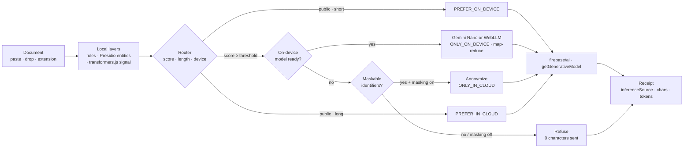

# VaultBrief

**Brief anything. Keep what's private private.**

VaultBrief is a hybrid-AI briefing desk built for [#BuildHybridAI 2026](https://firebasehybridaihackathon.devpost.com/) with **Firebase AI Logic hybrid inference**: private documents are briefed by Gemini Nano **on your device**, public ones go to a cloud-hosted Gemini model, and every request leaves a **receipt** that states which one ran and exactly how many characters crossed the network boundary.

Most summarisers ask you to trust them with whatever you paste. VaultBrief decides *before* reading whether the text is allowed to leave the machine — a local scan, not a model, makes that call.

```
Medical record, NDA, payslip   →  Gemini Nano / WebLLM on-device  ·  0 characters sent
Public article, long report    →  Cloud Gemini           ·  long-form synthesis
Sensitive + no local model     →  masked copy only        ·  identifiers replaced
Sensitive + masking switched off →  refused               ·  nothing is uploaded
Sensitive + nothing maskable   →  refused                 ·  Auto never sends it
```

---

## Judge quick start (60 seconds)

1. Open the live demo in any browser. **No Firebase project is needed to look around**: demo mode is loud about itself, and every receipt is stamped `simulated`.
2. Press **Brief this document** on the pre-loaded hospital summary. The routing console explains the decision before you press; the brief and the privacy receipt appear after.
3. Press **Public policy newsletter**, then **Brief this document**: the route flips to `☁ prefer_in_cloud` and the receipt shows the characters that were sent.
4. Turn **Mask identifiers before cloud** off on the private sample and press again: the run is refused, with the remedy.

With Chrome 139+ on desktop (Gemini Nano installed) the private sample runs `◆ only_on_device` with `0` characters sent. Without Nano, the same route runs on **WebLLM** wherever WebGPU exists (the model is a one-click, one-time download); each engine's status is shown in the device panel before you press anything. Details: [docs/SETUP-FIREBASE.md](docs/SETUP-FIREBASE.md) and the shot list in [docs/DEMO-SCRIPT.md](docs/DEMO-SCRIPT.md).

## Architecture



The same diagram without Mermaid:

```
document → rules + Presidio entities + local embeddings → router
                               ├─ sensitive → device ready? ─ yes → Gemini Nano / WebLLM (only_on_device)
                               │              └─ no → maskable? ─ yes → masked copy (only_in_cloud)
                               │                                └─ no  → refuse
                               ├─ public + short → prefer_on_device
                               └─ public + long  → prefer_in_cloud
                                          all routes → one firebase/ai call site → receipt
```

## Three local engines, one route

The private route is not tied to one browser API. `src/engine/deviceRuntime.ts` resolves, in order:

| Engine | When it runs | What it costs | Where the code is |
| --- | --- | --- | --- |
| **Gemini Nano** (Prompt API, via AI Logic) | Chrome 139+ desktop with the built-in model | 0 bytes sent; model already installed | `src/engine/hybrid.ts` |
| **WebLLM** (`mlc-ai/web-llm`, WebGPU) | Any browser with a WebGPU adapter (Edge, Chrome without Nano) | one model download (0.5B ≈ 945 MB VRAM), then offline | `src/engine/webllm.ts` |
| **transformers.js** (`huggingface/transformers.js`) | Always, when enabled | ~23 MB embedding model, cached | `src/engine/embeddings.ts` |

transformers.js does three jobs a keyword list cannot: a **semantic sensitivity signal** that recognises a paraphrase ("white cell count … two week course of tablets") with no health keyword in it; **collapsing repeated passages** before they become another on-device pass; and **removing near-duplicate brief points** after a map-reduce merge. Calibration is measured, not guessed: a real paraphrase scores 0.46–0.47 against its anchor, an ordinary paragraph 0.04–0.17, a business paragraph 0.27 (ignored). The model is English-only, so Korean text keeps relying on the Korean rules — stated here rather than glossed over.

## The masking layer (Presidio)

`microsoft/presidio` cannot run in a browser tab (Python + spaCy), so its **semantics** were ported to TypeScript in `src/engine/presidio/` and the real thing runs as an oracle:

- Same `RecognizerResult` / `AnalysisExplanation` shapes, `validate_result` → `invalidate_result_score` (0.4), the 0.35 context-word boost over a 5-token prefix window, `remove_duplicates` on overlapping spans, and the anonymizer's `replace` / `redact` / `mask` / `hash` / `keep` operators.
- Adds what stock Presidio lacks: Korean resident numbers **with the real check digit**, business registration numbers, driver licences, passports, bank accounts, and IBAN mod-97 / Luhn / US-SSN range checks. A failing check digit lowers confidence instead of discarding the match — test data is usually invalid, and invalid data is still private.
- `scripts/presidio-oracle.py` runs `presidio-analyzer 2.2.366` over `docs/pii-corpus.json` and writes `docs/presidio-oracle.json`; `src/engine/presidio-oracle.test.ts` holds the port to it, including the noise Presidio produces (it labels `0134`, `Q3` and `quarterly` as dates) that this port does not reproduce.

The router sees the union of both layers, so an identifier only the entity layer knows about (an IBAN, a driver licence) still raises the score and is still masked.

## Why hybrid

On-device models are fast, free and private, but they are not everywhere and they cannot hold a long document. Cloud models are capable and always available, but sending a patient record to one is a decision most people would refuse if they were asked.

VaultBrief makes that decision explicit and inspectable:

| Signal | Route | Why |
| --- | --- | --- |
| Sensitivity score ≥ 40 | `ONLY_ON_DEVICE` | Identifiers, health, finance, credentials and legal terms stay on the device, even if that means refusing to run. |
| Public and ≤ 2,600 chars | `PREFER_ON_DEVICE` | Free, instant, works offline; cloud only if the browser has no local model. |
| Public and > 2,600 chars | `PREFER_IN_CLOUD` | Long-form synthesis is what the cloud model is for. |
| Long and private | `ONLY_ON_DEVICE`, map-reduce | Chunked into on-device passes, then merged hierarchically — still 0 characters sent. The run can be stopped between passes. |
| Sensitive, no local model, masking on | `ONLY_IN_CLOUD` + redaction | Only a copy with `[REDACTED:CONTACT]`-style placeholders is transmitted, and the receipt says which topics the masked copy still reveals. |
| Sensitive, no local model, masking off | **blocked** | The invariant: identified text is never sent to the cloud. |
| Sensitive by topic only (nothing maskable) | **blocked** under Auto | Masking would reproduce the document; Auto does not pretend that is privacy. `Cloud quality` can override, knowingly. |

The three policies in the UI (`Auto`, `Device only`, `Cloud quality`) change the preference, never the invariant. The threshold itself is a Remote Config value, so a team can tighten or relax it without a deploy; it is clamped to 1–100 and shown in the console.

## What you see

- **Sensitivity scan** — 16 local rules, scored 0–100, on every keystroke, never touching the network: emails, Korean and international phone numbers, Korean resident numbers, Luhn-checked card numbers, bank/business numbers, passports, medical-record and licence numbers, dates of birth, postal addresses, named individuals, credentials and provider tokens (AWS, GitHub, Google, OpenAI, Slack, JWTs, private keys), plus health / finance / legal vocabulary in English **and Korean**.
- **Routing decision** — the exact `InferenceMode`, the reason, the number of maskable identifiers and the expected number of passes, before you press anything.
- **Brief** — title, TL;DR, key points and flags as strict JSON, from either model, in the language of the document.
- **Privacy receipt** — where it actually ran (from `response.inferenceSource`, not from what we asked for), the model, latency, passes, characters sent vs. kept, tokens, and any fallback or masking caveat.
- **Ledger** — every run for this browser: on-device share, characters kept local, cloud tokens avoided, estimated spend avoided. Simulated runs are counted as runs but excluded from tokens and dollars: a run in which no model was called cannot have saved a bill.

## How Firebase AI Logic is used

One model object cache, one call site, and the SDK decides where the prompt runs (`src/engine/hybrid.ts`):

```ts
import { getAI, getGenerativeModel, GoogleAIBackend, InferenceMode } from "firebase/ai";

const ai = getAI(firebaseApp, {
  backend: new GoogleAIBackend(),
  useLimitedUseAppCheckTokens: true,   // generative models enforce replay protection
});

const model = getGenerativeModel(ai, {
  mode: InferenceMode.PREFER_ON_DEVICE,
  inCloudParams: {
    model: "gemini-3.5-flash-lite",     // Remote Config can rename it per call
    generationConfig: { responseMimeType: "application/json", responseJsonSchema: BRIEF_SCHEMA },
  },
  onDeviceParams: {
    createOptions: {
      expectedInputs: [{ type: "text", languages: ["en"] }],
      expectedOutputs: [{ type: "text", languages: ["en"] }],
    },
  },
});

// inside a click handler: Chrome only downloads the model with user activation
await model.initializeDeviceModel((progress) => setDownloadProgress(progress));

const result = await model.generateContent(prompt, { signal, timeout: 90_000 });
const source = result.response.inferenceSource; // "on_device" | "in_cloud"
```

| File | Role |
| --- | --- |
| `src/engine/hybrid.ts` | The only file that imports `firebase/ai`. App Check, mode mapping, `initializeDeviceModel`, per-call cloud model + abort/timeout, error translation. |
| `src/engine/router.ts` | Decides the inference mode from sensitivity + length + device state; enforces the masking invariant; clamps the threshold. |
| `src/engine/sensitivity.ts` | Local scan and redaction. No network, no model. `keywordPattern` builds Korean-safe keyword regexes. |
| `src/engine/engine.ts` | Orchestration: scan → route → mask → chunk → generate → hierarchical merge → receipt. Supports `AbortSignal`. |
| `src/engine/chunk.ts` | Paragraph/sentence splitter with a bounded overlap and a merge-prompt grouper. |
| `src/engine/device.ts` | Read-only `LanguageModel.availability()` probe (current and legacy API shapes) for the capability panel. |
| `src/engine/remote.ts` | Remote Config overrides (`sensitivity_threshold`, `cloud_model`) with an 8 s timeout; defaults on every failure. |
| `src/engine/store.ts` | Ledger persistence (localStorage, validated) and fire-and-forget Firestore mirroring. |
| `src/engine/metrics.ts` | Ledger maths; simulated runs never produce a dollar figure. |

### Firebase products

| Product | Where | Notes |
| --- | --- | --- |
| **AI Logic (hybrid)** | `src/engine/hybrid.ts` | Required runtime path: imported and called on every brief. |
| **App Check** | `src/engine/hybrid.ts` | Enforced for AI Logic. reCAPTCHA Enterprise in production; a registered debug token for review builds (`FIREBASE_APPCHECK_DEBUG_TOKEN`, a UUID keeps it stable). |
| **Remote Config** | `src/engine/remote.ts` | Sensitivity threshold and model name, fetched on connect, applied per call. |
| **Firestore** | `src/engine/store.ts` + `firestore.rules` | Optional: mirrors receipts under the anonymous user's own document, with type and size limits in the rules. No document text is stored. |
| **Authentication** | `src/engine/store.ts` | Optional anonymous sign-in, only for the Firestore mirror. |

## Run it

```bash
npm install
cp .env.example .env.local      # add your Firebase web config + App Check
npm run dev                     # http://localhost:5173
npm test                        # 140 unit, integration and UI tests
npm run build                   # static build in dist/
```

No Firebase config? The app starts in **demo mode**: the banner says so, every receipt is stamped `simulated`, and briefs come from a local extractive summariser. That mode exists so the routing, masking and receipt logic can be reviewed end to end — it is never presented as a model call, and it produces no dollar figures.

No on-device model (any non-Chrome browser, or Chrome without the API)? The app still works: private documents take the masked-cloud route, or are refused. See [docs/SETUP-FIREBASE.md](docs/SETUP-FIREBASE.md) for the project, AI Logic provisioning (`npx firebase-tools init ailogic`), App Check, Remote Config and hosting steps.

### On-device requirements

Chrome 139+ on desktop with the built-in AI (Prompt API); older builds need `chrome://flags/#prompt-api-for-gemini-nano-multimodal-input` set to *Enabled*. The first request (or the “Download Gemini Nano” button) fetches the model; progress is shown in the device panel. The model is created for English input/output, but Korean documents are still briefed in Korean because the prompt asks for the document's language.

## Tests and evidence

```bash
npm test                        # 140 passing: scan/redact (incl. Korean and
                                # overlapping spans), routing, chunking, merging,
                                # cancellation, JSON parsing, ledger maths, device
                                # probe, config parsing, storage, a jsdom run of the
                                # whole screen, the Presidio port + its oracle
                                # comparison, WebLLM against a fake engine and the
                                # real model catalogue, embeddings maths, and the
                                # three layers wired together end to end
npm run verify:oss              # dependency + API-surface contract for the three OSS
npm run verify:extension        # MV3 manifest, icons, CSP-safe markup, message origin
node scripts/verify-sdk-path.mjs  # real SDK contract check (no project needed)
npm run verify                  # typecheck, tests, build, extension, OSS contract

# opt-in live model checks (downloads ~23 MB)
VAULTBRIEF_LIVE_MODELS=1 npx vitest run src/engine/embeddings.test.ts
python3 scripts/presidio-oracle.py --check   # needs presidio-analyzer + en_core_web_sm
```

`scripts/verify-sdk-path.mjs` checks the real SDK without any project. It confirms the exported `InferenceMode` values match the router, builds a model from exactly the parameters above, and calls `generateContent()` — which reaches Google and fails only on the deliberately fake key. Saved output: [`evidence/sdk-contract-check.json`](evidence/sdk-contract-check.json).

```
"generateContent": {
  "latencyMs": 491,
  "error": { "code": "fetch-error",
    "message": "AI: Error fetching from https://firebasevertexai.googleapis.com/v1beta/projects/
                vaultbrief-contract-check/models/gemini-3.5-flash-lite:generateContent:
                [400 Bad Request] API key not valid." }
}
```

`npm run verify:extension` checks what a "load unpacked" would otherwise only reveal in Chrome: valid MV3 JSON, every referenced file present, real PNG icons at the declared sizes, no inline script or handler (MV3 CSP), an explicit `postMessage` target origin, the iframe-load queue, and the permission set. Saved output: [`evidence/extension-check.json`](evidence/extension-check.json).

## Chrome extension

`extension/` is an MV3 side panel: it extracts the readable text of the current tab and hands it to the running app in an iframe, so the AI work still happens on the app's https origin with App Check intact. Icons are generated by `npm run icons` (no binary blobs you cannot regenerate).

1. `npm run dev` (or your hosted URL).
2. `chrome://extensions` → Developer mode → **Load unpacked** → `extension/`.
3. Press the toolbar icon, set the App URL once, press **Brief this page**.

See [extension/README.md](extension/README.md) for permissions and limits.

## Security model

- **The browser is the boundary.** The scan, the router, the masking and the receipt are local TypeScript; none of them calls a model. Masking runs the Presidio-derived entity layer first (typed placeholders per category) and then the regex sweep, so a value is never left behind because one layer missed it. `router.ts` is the only module that can decide a character may reach the cloud, and it refuses rather than softening.
- **App Check protects the quota.** Every AI Logic call carries a limited-use App Check token; a stolen config alone cannot spend your Gemini quota. The debug token path exists for review builds and is never committed.
- **Receipts are the only thing stored.** Firestore receives counts and short notes under an anonymous uid, scoped by rules to that uid, with type and size limits. Document text is never written.
- **The extension runs no model and holds no key.** It reads the page after your click and posts text to the origin you configured; the app drops messages that do not come from its own origin or a `chrome-extension://` parent.

## What is not claimed

- No PDF or Word parser: the app reads pasted text and plain-text files (up to 2 MB / 60,000 characters). A scanned PDF is not read.
- The dollar figure is an estimate at a configurable list price (`src/engine/metrics.ts`), not a bill; simulated runs are excluded entirely.
- The demo-mode simulator is an extractive summariser, not a model.
- Keyword signals (health, finance, legal) are vocabulary, not understanding: they raise the score and are reported, but they cannot be masked away, and a document that only trips them is blocked under Auto rather than silently sent.
- The extension has not been exercised against a live Chrome profile by the automated tests; its manifest, assets, CSP-relevant markup and message contract are checked by `npm run verify:extension`.
- Live end-to-end verification against a real Firebase project and a real Gemini Nano install is still outstanding in this environment; everything up to the network boundary is verified, and the contract check reaches Google's endpoint.
- The WebLLM path is verified against a fake `MLCEngineInterface` and the real model catalogue (ids and VRAM figures come from the installed package), not on a GPU in this workspace: there is no WebGPU adapter here. On a WebGPU machine the panel reports the adapter, downloads the model and serves the private route; if it fails, the run **stops** rather than falling back to the cloud.
- The semantic signal is English-only (MiniLM-L6-v2). Korean coverage comes from the Korean rules in `sensitivity.ts` and the Korean recognizers in `presidio/recognizers.ts`.
- Local inference quality on a 0.5B model is not Gemini-class: the compact model exists so the private route works at all on modest GPUs, and the 1.5B option is one dropdown away.

## License

Apache 2.0 — see [LICENSE](LICENSE).
