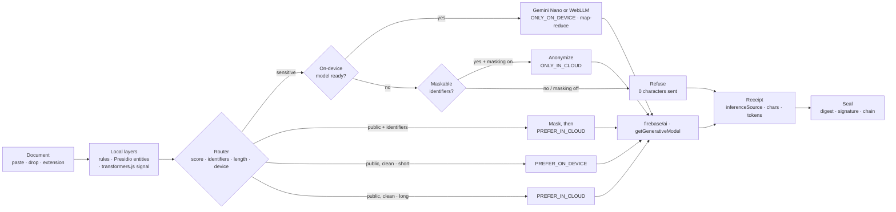

# VaultBrief

**Brief anything. Keep what's private private.**

VaultBrief is a hybrid-AI briefing desk built for [#BuildHybridAI 2026](https://firebasehybridaihackathon.devpost.com/) with **Firebase AI Logic hybrid inference**: private documents are briefed by Gemini Nano **on your device**, public ones go to a cloud-hosted Gemini model, and every request leaves a **verifiable privacy receipt** that states which one ran, exactly how many characters crossed the network boundary, and a SHA-256 fingerprint of the document it was issued for.

Most summarisers ask you to trust them with whatever you paste. VaultBrief decides *before* reading whether the text is allowed to leave the machine — a local scan, not a model, makes that call — and then proves what it did in a receipt anyone can check.

```
Medical record, NDA, payslip   →  Gemini Nano / WebLLM on-device  ·  0 characters sent
Public article, long report    →  Cloud Gemini, identifiers masked
Sensitive + no local model     →  masked copy only        ·  identifiers replaced
Sensitive + masking switched off →  refused               ·  nothing is uploaded
Sensitive + nothing maskable   →  refused                 ·  Auto never sends it
```

## What is new in v1.2 (this audit round)

| Upgrade | Why it matters |
| --- | --- |
| **Identifier-level invariant.** Any document carrying a maskable identifier is masked before *any* cloud call, however public the rest of the text is; with masking off, the run is refused. | The old gate was the 0–100 score, so a public newsletter with one footer address went to the cloud unmasked — a hole in the app's own headline claim. |
| **Verifiable receipts.** Each receipt is sealed: canonical SHA-256 digest, document fingerprint, ECDSA P-256 signature from a per-browser key, and a `prev`/`seq` chain inside the ledger. A verifier panel and `scripts/verify-receipt.mjs` check it with no app, no project and no network. | "The receipt says 0 characters were sent" used to be a claim the app could edit. Now an edit breaks the digest, a different document breaks the fingerprint, and a deleted run breaks the chain. |
| **Correct hybrid device preparation.** `PREFER_ON_DEVICE` and `ONLY_ON_DEVICE` are separate model objects in the SDK; both are now initialised inside the click, and a device mode that was never prepared gets one lazy attempt. | Preparing only the probe model left the mode the router actually selects unprepared on the first private document. |
| **Routing sees the post-preparation device.** | Pressing Brief while Nano was still downloadable prepared the model and then routed as if it were absent — a blocked run on a machine that had just become capable. |
| **Per-pass route accounting.** A mixed run reports where every pass ran instead of echoing the last one. | A receipt must not summarise a mixed run as if only its last pass existed. |
| **Two-way extension bridge.** `hello → ready → receipt`, protocol-versioned, replies only to the frame that spoke. | The panel used to fire a document into the iframe and hope; now it knows the app accepted it and shows the receipt summary. |
| **Firestore rules that match the receipt.** | The mirror was silently rejecting every real receipt because `pii`, `semantic`, `local`, `split` and `integrity` were not in `hasOnly` — and undefined fields made the SDK throw. A test now compares the mirror payload with the rules file. |
| **One analysis per edit instead of four.** | 60,000 characters: 256 ms instead of 453 ms (measured, `src/engine/perf.test.ts`). |
| **Korean names without labels, security headers, honest docs.** | "김민수 씨", "이지훈 과장" are now recognised; `public/_headers` ships a CSP allowlist; the README, demo script and submission text no longer disagree about the test count. |

The full seven-step audit — findings, severities, strategy, process, evidence — is in [docs/DEEP-AUDIT-AND-UPGRADE.md](docs/DEEP-AUDIT-AND-UPGRADE.md).

---

## Judge quick start (60 seconds)

1. Open the live demo in any browser. **No Firebase project is needed to look around**: demo mode is loud about itself, and every receipt is stamped `simulated`.
2. Press **Brief this document** on the pre-loaded hospital summary. The routing console explains the decision before you press; the brief and the privacy receipt appear after. Press **Verify receipt** in the receipt and then **Verify**: the panel recomputes the digest, checks the signature, and confirms the document fingerprint.
3. Press **Public policy newsletter**, then **Brief this document**: the route flips to `☁ prefer_in_cloud`, and its one footer address is replaced before the copy is sent.
4. Turn **Mask identifiers before cloud** off on the private sample and press again: the run is refused, with the remedy.

With Chrome 139+ on desktop (Gemini Nano installed) the private sample runs `◆ only_on_device` with `0` characters sent. Without Nano, the same route runs on **WebLLM** wherever WebGPU exists (the model is a one-click, one-time download); each engine's status is shown in the device panel before you press anything. Details: [docs/SETUP-FIREBASE.md](docs/SETUP-FIREBASE.md) and the shot list in [docs/DEMO-SCRIPT.md](docs/DEMO-SCRIPT.md).

## Architecture



The same diagram without Mermaid:

```
document → rules + Presidio entities + local embeddings → router
     ├─ sensitive → device ready? ─ yes → Gemini Nano / WebLLM (only_on_device)
     │              └─ no → maskable? ─ yes → masked copy (only_in_cloud)
     │                                └─ no  → refuse
     ├─ public + identifiers → mask first, then cloud (prefer_in_cloud)
     ├─ public, clean + short → prefer_on_device
     └─ public, clean + long  → prefer_in_cloud
                                every route → one firebase/ai call site → receipt → seal
```

## The invariant: identifiers, not scores

`src/engine/router.ts` is the only module that can let text reach the cloud, and it applies one rule:

> A run that would send text to the cloud either carries zero maskable identifiers, or is refused.

The 0–100 score still decides *sensitivity* — a medical record stays on the device even if every identifier were removed — but the masking rule no longer depends on it. That distinction is what makes "no identifier ever crosses unmasked" true for a public press release with a media-contact address, not just for a discharge summary. Three policies (`Auto`, `Device only`, `Cloud quality`) change the preference, never the invariant; the threshold itself is a Remote Config value, clamped to 1–100 and shown in the console.

## Three local engines, one route

The private route is not tied to one browser API. `src/engine/deviceRuntime.ts` resolves, in order:

| Engine | When it runs | What it costs | Where the code is |
| --- | --- | --- | --- |
| **Gemini Nano** (Prompt API, via AI Logic) | Chrome 139+ desktop with the built-in model | 0 bytes sent; model already installed | `src/engine/hybrid.ts` |
| **WebLLM** (`mlc-ai/web-llm`, WebGPU) | Any browser with a WebGPU adapter (Edge, Chrome without Nano) | one model download (0.5B ≈ 945 MB VRAM), then offline | `src/engine/webllm.ts` |
| **transformers.js** (`huggingface/transformers.js`) | Always, when enabled | ~23 MB embedding model, cached | `src/engine/embeddings.ts` |

Both on-device modes are initialised inside the click that starts a run, because `initializeDeviceModel()` is what Chrome gates behind user activation. transformers.js does three jobs a keyword list cannot: a **semantic sensitivity signal** that recognises a paraphrase ("white cell count … two week course of tablets") with no health keyword in it; **collapsing repeated passages** before they become another on-device pass; and **removing near-duplicate brief points** after a map-reduce merge. Calibration is measured, not guessed: a real paraphrase scores 0.46–0.47 against its anchor, an ordinary paragraph 0.04–0.17, a business paragraph 0.27 (ignored). The model is English-only, so Korean text keeps relying on the Korean rules — stated here rather than glossed over.

## The masking layer (Presidio)

`microsoft/presidio` cannot run in a browser tab (Python + spaCy), so its **semantics** were ported to TypeScript in `src/engine/presidio/` and the real thing runs as an oracle:

- Same `RecognizerResult` / `AnalysisExplanation` shapes, `validate_result` → `invalidate_result_score` (0.4), the 0.35 context-word boost over a 5-token prefix window, `remove_duplicates` on overlapping spans, and the anonymizer's `replace` / `redact` / `mask` / `hash` / `keep` operators.
- Adds what stock Presidio lacks: Korean resident numbers **with the real check digit**, business registration numbers, driver licences, passports, bank accounts, and IBAN mod-97 / Luhn / US-SSN range checks. A failing check digit lowers confidence instead of discarding the match — test data is usually invalid, and invalid data is still private.
- Recognises Korean names the way Korean prose writes them: after a field label (`성명: 김민수`) and after an honorific or job title (`김민수 씨`, `이지훈 과장`), with a stoplist so `고객님` and `회원님` are not turned into people.
- `scripts/presidio-oracle.py` runs `presidio-analyzer 2.2.366` over `docs/pii-corpus.json` and writes `docs/presidio-oracle.json`; `src/engine/presidio-oracle.test.ts` holds the port to it, including the noise Presidio produces (it labels `0134`, `Q3` and `quarterly` as dates) that this port does not reproduce.

The router sees the union of both layers, so an identifier only the entity layer knows about (an IBAN, a driver licence) still raises the score and is still masked.

## Verifiable receipts

A receipt that only the issuing tab can vouch for is a screenshot. Every completed run is sealed (`src/engine/receipt.ts`):

| Field | What it proves |
| --- | --- |
| `digest` | SHA-256 over the canonical receipt body, its chain position and the document fingerprint. Edit any field and the digest no longer matches. |
| `documentSha256` | The receipt is bound to one document. A verifier who holds the document can confirm it; nobody else learns anything, because a hash cannot be reversed and the text is never stored or sent. |
| `signature` + `publicKey` + `keyId` | ECDSA P-256 over the same body, signed by a key generated once per browser and carried inside the receipt. Anyone can verify it with no key exchange. |
| `prev` + `seq` | The receipt is linked to the one before it in this browser's ledger, so a deleted or reordered run leaves a gap. |

In the app: **Verify receipt** in the receipt block opens a verifier that recomputes everything and shows each check with its result, including the document binding when the document is in the box. From a terminal:

```bash
npm run verify:receipt        # the committed sample, 5/5 checks
node scripts/verify-receipt.mjs --receipt my-receipt.json \
     --document my-document.txt --previous <previous digest>
```

```
PASS  integrity block       v2 · ECDSA-P256-SHA256 · seq 7
PASS  digest                sha256 8960d51be6545617ad76f5d00b83f4c2…
PASS  signature             ECDSA P-256 valid · key f5195b8ca95bfc98
PASS  document fingerprint  sha256 a505d4dabcde46c7557263c4c795c844… matches receipt-sample-document.txt
PASS  ledger chain          follows bbbbbbbbbbbbbbbb…
VERIFIED — 5/5 checks passed
```

What this is **not**: a third-party attestation. A signature proves the receipt was produced by that key and not edited since; a determined forger would mint a new key, which shows up as a different `keyId`. The digest, the document binding, the chain and the internal consistency checks (a device run cannot have sent characters; the counts must add up) are what make an edited receipt obvious.

## What you see

- **Sensitivity scan** — 16 local rules, scored 0–100, on every keystroke, never touching the network: emails, Korean and international phone numbers, Korean resident numbers, Luhn-checked card numbers, bank/business numbers, passports, medical-record and licence numbers, dates of birth, postal addresses, named individuals, credentials and provider tokens (AWS, GitHub, Google, OpenAI, Slack, JWTs, private keys), plus health / finance / legal vocabulary in English **and Korean**.
- **Routing decision** — the exact `InferenceMode`, the reason, the number of maskable identifiers and the expected number of passes, before you press anything.
- **Brief** — title, TL;DR, key points and flags as strict JSON, from either model, in the language of the document.
- **Privacy receipt** — where it actually ran (from `response.inferenceSource`, aggregated over every pass), the model, latency, passes (split by side on a mixed run), characters sent vs. kept, tokens, any masking caveat, and the seal.
- **Ledger** — every run for this browser: on-device share, characters kept local, cloud tokens avoided, estimated spend avoided. Simulated runs are counted as runs but excluded from tokens and dollars: a run in which no model was called cannot have saved a bill.

## How Firebase AI Logic is used

One model object cache, one call site, and the SDK decides where the prompt runs (`src/engine/hybrid.ts`):

```ts
import { getAI, getGenerativeModel, GoogleAIBackend, InferenceMode } from "firebase/ai";

const ai = getAI(firebaseApp, {
  backend: new GoogleAIBackend(),
  useLimitedUseAppCheckTokens: true,   // generative models enforce replay protection
});

const model = getGenerativeModel(ai, {
  mode: InferenceMode.PREFER_ON_DEVICE,
  inCloudParams: {
    model: "gemini-3.5-flash-lite",     // Remote Config can rename it per call
    generationConfig: { responseMimeType: "application/json", responseJsonSchema: BRIEF_SCHEMA },
  },
  onDeviceParams: {
    createOptions: {
      expectedInputs: [{ type: "text", languages: ["en"] }],
      expectedOutputs: [{ type: "text", languages: ["en"] }],
    },
  },
});

// inside a click handler: Chrome only downloads the model with user activation
await model.initializeDeviceModel((progress) => setDownloadProgress(progress));

const result = await model.generateContent(prompt, { signal, timeout: 90_000 });
const source = result.response.inferenceSource; // "on_device" | "in_cloud"
```

| File | Role |
| --- | --- |
| `src/engine/hybrid.ts` | The only file that imports `firebase/ai`. App Check, mode mapping, `initializeDeviceModel` for both device modes, per-call cloud model + abort/timeout, error translation. |
| `src/engine/router.ts` | Decides the inference mode from sensitivity, identifiers, length and device state; enforces the invariant; clamps the threshold. |
| `src/engine/sensitivity.ts` | Local scan and redaction. No network, no model. `keywordPattern` builds Korean-safe keyword regexes. |
| `src/engine/pii.ts` | Combines the rule scan with the Presidio entity layer and produces the masked copy. |
| `src/engine/engine.ts` | Orchestration: scan → route → mask → chunk → generate → hierarchical merge → receipt → seal. Supports `AbortSignal`. |
| `src/engine/receipt.ts` | Canonical body, SHA-256 digest, document fingerprint, ECDSA seal, chain link, verification. |
| `src/engine/hash.ts` | Dependency-free SHA-256 and canonical JSON that behave identically in the browser, Node and the CLI. |
| `src/engine/chunk.ts` | Paragraph/sentence splitter with a bounded overlap and a merge-prompt grouper. |
| `src/engine/device.ts` | Read-only `LanguageModel.availability()` probe (current and legacy API shapes) for the capability panel. |
| `src/engine/remote.ts` | Remote Config overrides (`sensitivity_threshold`, `cloud_model`) with an 8 s timeout; defaults on every failure. |
| `src/engine/store.ts` | Ledger persistence (localStorage, validated) and fire-and-forget Firestore mirroring of a Firestore-safe payload. |
| `src/engine/bridge.ts` | The versioned `hello`/`ready`/`receipt` contract with the Chrome side panel. |
| `src/engine/metrics.ts` | Ledger maths; simulated runs never produce a dollar figure. |

### Firebase products

| Product | Where | Notes |
| --- | --- | --- |
| **AI Logic (hybrid)** | `src/engine/hybrid.ts` | Required runtime path: imported and called on every brief. |
| **App Check** | `src/engine/hybrid.ts` | Enforced for AI Logic. reCAPTCHA Enterprise in production; a registered debug token for review builds (`FIREBASE_APPCHECK_DEBUG_TOKEN`, a UUID keeps it stable). |
| **Remote Config** | `src/engine/remote.ts` | Sensitivity threshold and model name, fetched on connect, applied per call. |
| **Firestore** | `src/engine/store.ts` + `firestore.rules` | Optional: mirrors receipts under the anonymous user's own document, with type, key and size limits in the rules. No document text is stored. |
| **Authentication** | `src/engine/store.ts` | Optional anonymous sign-in, only for the Firestore mirror. |

## Run it

```bash
npm install
cp .env.example .env.local      # add your Firebase web config + App Check
npm run dev                     # http://localhost:5173
npm test                        # 198 offline tests (1 opt-in live model check skipped)
npm run build                   # static build in dist/
```

No Firebase config? The app starts in **demo mode**: the banner says so, every receipt is stamped `simulated`, and briefs come from a local extractive summariser. That mode exists so the routing, masking, sealing and receipt logic can be reviewed end to end — it is never presented as a model call, and it produces no dollar figures.

No on-device model (any non-Chrome browser, or Chrome without the API)? The app still works: private documents take the masked-cloud route, or are refused. See [docs/SETUP-FIREBASE.md](docs/SETUP-FIREBASE.md) for the project, AI Logic provisioning (`npx firebase-tools init ailogic`), App Check, Remote Config and hosting steps.

### On-device requirements

Chrome 139+ on desktop with the built-in AI (Prompt API); older builds need `chrome://flags/#prompt-api-for-gemini-nano-multimodal-input` set to *Enabled*. The first request (or the “Prepare on-device model” button) fetches the model; progress is shown in the device panel. The model is created for English input/output, but Korean documents are still briefed in Korean because the prompt asks for the document's language.

## Tests and evidence

```bash
npm test                        # 199 tests: 198 offline + 1 opt-in live model check
npm run verify                  # typecheck, tests, build, extension, receipt, OSS contract
npm run verify:extension        # 9 static MV3 checks, incl. the bridge protocol
npm run verify:receipt          # 5 checks on the committed sample receipt
npm run verify:oss              # 26 dependency, API-surface, header and corpus checks
node scripts/verify-sdk-path.mjs  # real SDK contract check (no project needed)
```

| Area | What is locked | Where |
| --- | --- | --- |
| Scan, mask, Korean | 19 tests: identifiers, Luhn, provider tokens, names with and without labels, residual topics, phone-vs-account overlap | `sensitivity.test.ts` |
| Router | 19 tests: every mode, the identifier invariant, masking refusal, threshold clamping, empty input | `router.test.ts` |
| Presidio port | 17 tests: recognizers, checksums, context boost, overlap, anonymizer operators, Korean honorifics | `presidio.test.ts` |
| Oracle | 6 tests comparing the port with presidio 2.2.366 over a labelled corpus, including the false positives it refuses to copy | `presidio-oracle.test.ts` |
| Hybrid client | 14 tests against a fake SDK: App Check ordering, model caching per mode, both device modes prepared, lazy preparation, abort/timeout, error translation | `hybrid.test.ts` |
| Receipts | 16 tests: seal, tamper, wrong document, spliced signature, chain, digest-only, legacy, CLI round-trip, rules drift | `receipt.test.ts` |
| Bridge | 6 tests: origin rules, clipping, malformed messages, protocol, receipt summary | `bridge.test.ts` |
| Pipeline | 21 tests: device route, map-reduce, masked cloud, refusal, cancellation, Presidio masking, embedder failures | `engine.test.ts`, `integration.test.ts` |
| Screen | 9 jsdom tests: demo banner, routing preview, a full run, refusal, extension handshake, verifier | `ui.test.tsx` |
| Cost | 2 measured budgets for the per-keystroke analysis | `perf.test.ts` |
| Everything else | chunking, merging, prompt parsing, ledger maths, config parsing, storage, device probe, WebLLM adapter, SHA-256 vectors | the remaining files |

Saved evidence: [`evidence/sdk-contract-check.json`](evidence/sdk-contract-check.json) (a real HTTP 400 from `firebasevertexai.googleapis.com` with a deliberately fake key), [`evidence/extension-check.json`](evidence/extension-check.json), [`evidence/receipt-sample.json`](evidence/receipt-sample.json) + its document, and the live screenshots in `evidence/`.

## Chrome extension

`extension/` is an MV3 side panel: it extracts the readable text of the current tab and hands it to the running app in an iframe, so the AI work still happens on the app's https origin with App Check intact. Icons are generated by `npm run icons` (no binary blobs you cannot regenerate).

The panel and the app speak a versioned protocol (`src/engine/bridge.ts`): the panel says `hello`, the app answers `ready` with its protocol and version, the document follows, and after the brief the app sends a compact `receipt` (route, characters sent, seal). The grab button unlocks only on a protocol match, and both sides accept messages only from the frame and origin they expect.

1. `npm run dev` (or your hosted URL).
2. `chrome://extensions` → Developer mode → **Load unpacked** → `extension/`.
3. Press the toolbar icon, set the App URL once, press **Brief this page**.

See [extension/README.md](extension/README.md) for permissions and limits.

## Security model

- **The browser is the boundary.** The scan, the router, the masking and the receipt are local TypeScript; none of them calls a model. Masking runs the Presidio-derived entity layer first (typed placeholders per category) and then the regex sweep, so a value is never left behind because one layer missed it. `router.ts` is the only module that can decide a character may reach the cloud, it decides by identifier, and it refuses rather than softening.
- **The receipt is sealed, and the seal covers the chain.** Digest, document fingerprint and ECDSA signature travel with the receipt; `prev`/`seq` link it to the rest of the ledger. `npm run verify:receipt` and the in-app verifier check it without trusting the app.
- **App Check protects the quota.** Every AI Logic call carries a limited-use App Check token; a stolen config alone cannot spend your Gemini quota. The debug token path exists for review builds and is never committed.
- **Receipts are the only thing stored.** Firestore receives counts, a document hash and short notes under an anonymous uid, scoped by rules to that uid, with key, type and size limits. Document text is never written — locally or remotely.
- **Transport headers say the same thing.** `public/_headers` ships `nosniff`, a strict referrer policy, no camera/microphone/geolocation, and a Content-Security-Policy that names Firebase, reCAPTCHA, jsDelivr and Hugging Face as the only reachable origins; `frame-ancestors` allows the side panel and nothing else.
- **The extension runs no model and holds no key.** It reads the page after your click and posts text to the origin you configured; the app drops messages that do not come from its own origin or a `chrome-extension://` parent, and replies only to the frame that spoke.

## What is not claimed

- No PDF or Word parser: the app reads pasted text and plain-text files (up to 2 MB / 60,000 characters). A scanned PDF is not read.
- The dollar figure is an estimate at a configurable list price (`src/engine/metrics.ts`), not a bill; simulated runs are excluded entirely.
- The demo-mode simulator is an extractive summariser, not a model.
- Keyword signals (health, finance, legal) are vocabulary, not understanding: they raise the score and are reported, but they cannot be masked away, and a document that only trips them is blocked under Auto rather than silently sent.
- The receipt signature is an issuing-key check, not a third-party attestation (see above). Clearing site data loses the key, so older receipts still verify individually but a new `keyId` starts the next chain.
- The CSP allowlist is explicit and therefore must be revisited if Firebase or Hugging Face move an endpoint; a blocked origin fails closed, not open.
- The extension has not been loaded in a live Chrome profile by the automated tests; its manifest, assets, CSP-relevant markup, handshake protocol and message contract are checked statically by `npm run verify:extension`.
- Live end-to-end verification against a real Firebase project is done (2026-11-25, project `vaultbrief-hybridai`): a real Gemini 3.5 Flash Lite call over Firebase AI Logic with App Check enforced, a sealed receipt verified 7/7 and a second one 8/8 with the ledger chain, and the receipt mirrored to Firestore under the anonymous user. A real Gemini Nano install is still unavailable in this environment: the live browser has no WebGPU adapter, so the on-device route was exercised only against the WebLLM/devices fakes and the reported fallback is what the receipt shows.
- The WebLLM path is verified against a fake `MLCEngineInterface` and the real model catalogue (ids and VRAM figures come from the installed package), not on a GPU in this workspace: there is no WebGPU adapter here. On a WebGPU machine the panel reports the adapter, downloads the model and serves the private route; if it fails, the run **stops** rather than falling back to the cloud.
- The semantic signal is English-only (MiniLM-L6-v2). Korean coverage comes from the Korean rules in `sensitivity.ts` and the Korean recognizers in `presidio/recognizers.ts`.
- Local inference quality on a 0.5B model is not Gemini-class: the compact model exists so the private route works at all on modest GPUs, and the 1.5B option is one dropdown away.
- The per-keystroke preview is measured at 256 ms for a 60,000-character document in this container; typical documents (a few thousand characters) are an order of magnitude cheaper, but the cap is a cap.

## License

Apache 2.0 — see [LICENSE](LICENSE).
